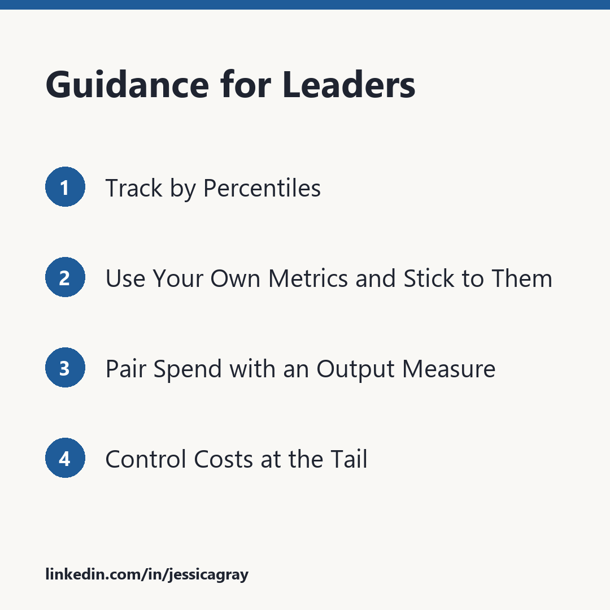

# How Does AI Spending Stack Up

## What’s Normal?

A question I see coming up more and more is how does my or my team’s usage and spending on AI stack up. Honestly, it is a tough question to answer today. You’ll see reporting from $50 to $1,200/month depending on the source and if you are looking at median or average. Even looking up personal usage and turning that into a business equivalent cost is a real challenge. If you have a personal free or fixed monthly cost account, give it a try and see the caveats that come up.

While it is difficult to understand current norms it is useful to explore them. AI shows a clear heavy right tail in its usage and costs. There is not a consensus on what to measure, and the market is still changing rapidly.

## Data Sources

Sources: [Jellyfish](https://jellyfish.co/blog/is-tokenmaxxing-cost-effective-new-data-from-jellyfish-explains/), [Anthropic](https://code.claude.com/docs/en/costs), [LinearB](https://linearb.io/resources/ai-engineering-productivity-gap), [Stanford AI Spend Index](https://aispendindex.stanford.edu/), [Vantage](https://tokens.vantage.sh/typical-spend)

## Wide Adoption with a Heavy Tail

In 2026, a large majority of engineers are using AI at least occasionally, though [few PRs come from autonomous agents](https://linearb.io/resources/ai-engineering-productivity-gap) so far. [JetBrains](https://blog.jetbrains.com/research/2026/08/ai-coding-agent-adoption-2026/) found 90% of developers use AI for coding at work at least weekly, with 68% using AI for coding daily. Only 23% of developers say they code mostly by hand, while 47% code AI-assisted, and 31% say AI mostly writes their code.

This kind of usage explains the wide variance in AI spend. Average monthly developer costs end up 5x+ median costs. A 90th percentile dev spends more than 10x on AI resources versus the median dev. This is important for technology leaders to keep in mind. Tracking averages does a very poor job of explaining what is happening, because a few heavy users skew the data dramatically.

The impact of skewed usage is particularly relevant in thinking about managing costs. A flat per head budget based on an average is a poor choice for cost estimation and control. Most users will not come close to it, while a few outliers will quickly exceed it.

One of the most surprising recent findings is that increases in AI spend are not matched linearly by increases in productivity. According to Jellyfish’s head of research, Nicholas Arcolano, ["The top 10% of engineers are about twice as productive as the median, and they spend 10x the tokens to get there."](https://workos.com/blog/nicholas-arcolano-jellyfish-token-maxing-diminishing-returns) Jellyfish also reported that in Q1 the top fifth of developers using AI merged about 2x the PRs of the bottom fifth, but the AI cost per merged PR ran from $0.28 to $89. There is a productivity benefit in terms of the number of PRs, but the drop off in marginal increase in PRs is rapid.

## Incomparable?

There is no standard way of looking at AI usage and spend, and it shows in these sources. Some sources count per active day. Others per month. Stanford averages per company instead of looking at the distribution within companies. Subscriptions blur things further: should usage be treated as billed at listed API rates instead of what it actually costs companies? And none of these touch the questions of sampling and missing details.

The most concerning of these to me is the lack of information on when data was collected. The use of AI in development is moving fast, and freshness is critical for understanding the relevance and applicability of findings. Since Q1 2026 there have been a number of developments in the industry. [Uber has reported](https://www.bloomberg.com/news/articles/2026-06-02/uber-caps-usage-of-ai-tools-like-claude-code-to-cut-costs) its AI budget challenges and added caps. Several other companies are reported to have implemented caps as well. [Gartner](https://gartner.com/en/newsroom/press-releases/2026-06-24-gartner-predicts-ai-coding-costs-will-surpass-average-developer-salary-by-2028-as-token-consumption-surges) even predicted average AI coding costs per developer will exceed the average developer salary by 2028. Information from 2025 would not paint an accurate picture today.

## Guidance for Leaders

### 1. Track by Percentiles

Treat AI spend like latency. Look at P10, median, P90, and max for your team, not just the mean.

### 2. Use Your Own Metrics and Stick to Them

All numbers have bias, but your own numbers should have consistent bias if you keep what you measure consistent.

Before using any benchmark, check what it reports, what timeframe it covers, and who it covers.

Watch for “lies, damn lies, and statistics” in numbers.

### 3. Pair Spend with an Output Measure

Could be something like cost per merged PR. Confirm usage aligns with the outcomes you want to drive.

### 4. Control Costs at the Tail

Don’t focus on per head budgets. Let people see their own spending. Provide approval paths to exceed standard caps.

## Where to Focus

The right question for technical leaders isn’t “is our spend normal?” We should be understanding who is spending what, and what they are getting from it.
